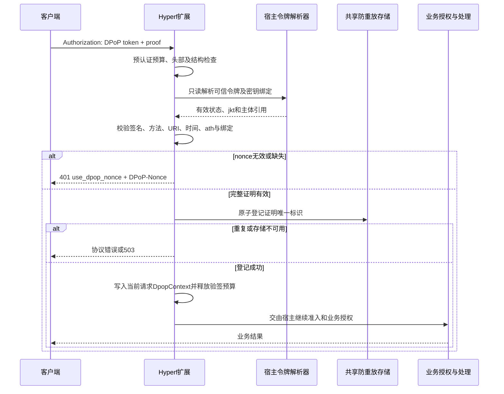

# Feature: 20261102_F001 - Hyperf DPoP 标准扩展

创建日期：2026-11-02（Asia/Shanghai）。版本：0.6。状态：Composer vendor确定为lowelllab，保留双包及现有PHP命名空间；生产容量、真实代理拓扑、独立安全审计和稳定发行仍待后续完成。

审查依据与修订：[首轮审查](review-20261102.md)、[整体功能复审](review-functional-20261102.md)。第18、19节为修订后的精确实施契约，冲突时以最新第19节为准。用户已授权直接修订并实施，不再设置方案二次确认门禁。

实施追踪入口：[实施进度与规则记录](implementation-progress.md)。后续进度、实施规则、决策、验证结果和遗留问题持续记录于该文件；技术契约调整时同步修订本方案并保留变更依据。

## 1. 需求背景

为使用最新稳定 PHP、Hyperf 的新项目提供独立、可复用的 DPoP 服务端组件，减少各业务仓库重复实现证明验证、nonce 和防重放的成本。

设计不继承任何既有项目的账号、员工、设备、数据库表、URL 前缀、响应信封及消息协议。依赖包应能够接入不同令牌格式和认证存储，不要求项目迁移至特定 OAuth 产品。

“标准”包含两方面：HTTP 语义遵循 RFC 9449；组件接入遵循 Hyperf 的 ConfigProvider、依赖注入和中间件机制。该称谓不表示官方归属，也不等于协议认证或安全审计完成。

## 2. 目标与范围

### 2.1 首版目标

1. 提供通用 HTTP DPoP 证明验证，支持签发、刷新和资源访问的不同校验上下文。
2. 为 Hyperf 提供可配置、可观测的集成层，支持路由或路由组选择性启用。
3. 通过可信令牌绑定解析接口，同时支持 JWT、不透明令牌和远程 introspection。
4. 提供安全默认值、显式错误契约及原子防重放存储接口。
5. 在多 Worker、多实例、协程并发及存储故障场景下验证安全行为。
6. 提供不依赖其他业务仓库的示例和自动化验收方案。

### 2.2 首版不包含

- 用户注册、密码验证、多因素认证、完整 OAuth 授权服务器。
- 业务角色、租户资源权限、账号停用规则及业务幂等引擎。
- WebSocket 认证协议及设备互踢；后续作为独立扩展设计。
- 浏览器或 Electron 密钥存储及签名 SDK。
- mTLS 证书签发、更新和吊销。
- 自动修改业务路由、自动撤销旧会话、安装时自动执行数据库迁移。

### 2.3 安全边界

DPoP 证明请求方持有令牌绑定的私钥，不证明终端获公司批准或客户端为官方安装包；无法阻止已控制合法客户端的攻击者调用签名能力。

HTTP proof 绑定方法、目标 URI 和资源访问令牌，不覆盖 query 与请求体完整性，不承担业务防重复提交。HTTPS、账号认证和业务授权继续是接入项目责任。

## 3. 技术基线与依赖选型

### 3.1 版本快照

以下信息于 2026-11-02 查询；后续实施开始时重新核对，不使用开发分支代表“最新稳定版”。

| 组件 | 查询到的稳定版本 | 方案选择 |
| --- | --- | --- |
| PHP | 8.5.12 | 包语言基线 `^8.5`，初始部署和 CI 使用 8.5.12；维护时更新安全补丁 |
| Hyperf Framework | 3.2.0 | Hyperf 适配组件约束 `~3.2.0`，各组件使用该系列实际稳定补丁 |
| Hyperf HTTP Server | 3.2.0 | HTTP 集成验证基线 |
| Hyperf WebSocket Server | 3.2.1 | 仅记录，不作为首版必需依赖 |
| Swoole | 6.2.4 | 首期完整运行时验证目标，使用 Linux CI |
| danielburger1337/oauth2-dpop | 1.2.0 | 主要协议候选，PHP `^8.4` 允许 PHP 8.5 |
| web-token/jwt-library | 4.2.4 | JOSE 能力候选，按实际使用的适配器显式声明依赖 |

Composer 的 PHP 版本约束不替代运行时安全补丁要求；不承诺所有满足依赖约束的 PHP、Swoole 组合都已通过测试。Swow、其他运行引擎和未来 Hyperf 次版本在增加 CI 验证后再声明支持。

### 3.2 三种方案比较

| 方案 | 优点 | 代价 | 决策 |
| --- | --- | --- | --- |
| 通用 DPoP 库 + 自有 Hyperf 适配 | 复用协议能力，将主要维护投入用于集成 | 需确认底层验证顺序、扩展接口和严格策略 | 优先验证并采用 |
| 直接基于 JOSE 库实现 DPoP 核心 | 策略、错误和存储时机完全可控 | RFC 行为、边界用例及审计成本更高 | 候选库不满足关键条件时再采用 |
| 移植 Laravel 或 JWT 认证整包 | 已有较多应用集成能力 | 引入无关框架依赖，限制令牌格式和业务模型 | 不采用 |

优先对 `danielburger1337/oauth2-dpop` 做一次有界验证：使用其证明验证与可替换 loader、nonce、replay 接口，或在安全顺序得到验证后由外层统一协调。不允许因默认可选而遗漏 nonce 或防重放，也不在两层重复消费同一证明。

最终依赖确定条件：满足第 9 节认证顺序、第 11 节存储保证和第 15 节验收项。若无法在不侵入上游内部实现的前提下满足条件，采用自有协议核心配合维护中的 JOSE 库，并记录原因。两条路线都不自行编写密码学签名算法。

## 4. 包结构与发布方式

采用单仓库、双包设计，避免首版按每种存储继续拆出过多包。

```text
hyperf-dpop/
├── README.md
├── spec/
│   └── feature_20261102_F001_hyperf-dpop-extension/
│       └── spec-design.md
├── packages/
│   ├── dpop-core/
│   │   ├── composer.json
│   │   ├── src/{Contract,Protocol,Nonce,ValueObject,Exception}/
│   │   └── tests/
│   └── hyperf-dpop/
│       ├── composer.json
│       ├── src/{ConfigProvider,Middleware,Adapter,Command}/
│       ├── publish/
│       └── tests/
├── examples/                         # 独立 Hyperf 合成示例
└── docs/                             # 接入、部署、验证和维护说明
```

- 包名为 `lowelllab/dpop-core`、`lowelllab/hyperf-dpop`，PHP命名空间保持 `Acme\Dpop`、`Acme\HyperfDpop`。Composer vendor与PHP命名空间独立；本次不改动现有类名。替代最初acme包名占位，命名决定见§19.12。
- 用户只安装 Hyperf 扩展，Composer 自动引入核心包。
- 核心包不依赖 Hyperf、Swoole 或某项目的数据库模型；只消费明确传入的参数、可信上下文和扩展接口。
- Hyperf 包通过 `extra.hyperf.config` 注册 ConfigProvider，提供依赖绑定及配置发布；中间件和业务路由由宿主显式启用。
- Redis、数据库和命令组件按实际启用能力声明可选依赖；启动时检查配置对应的依赖是否存在。
- 初期用 Composer path 仓库在独立示例内集成；验证完成后确定公共或私有发布渠道及双包版本策略。

## 5. 核心接口与宿主责任

以下为设计契约，具体 PHP 签名在实施阶段确定，不是已存在的可调用 API。

| 接口或对象 | 契约 | 责任边界 |
| --- | --- | --- |
| `ProofVerifierInterface` | 验证协议结构、签名及所需 claims，返回已验证证明 | 不自动建立业务用户身份 |
| `VerifiedProof` | 包含可信 jkt、jti、iat 及必要的经过验证的 claims | 不保留完整 token 或 proof 供日志输出 |
| `TokenBindingResolverInterface` | 根据 access token 返回可信有效状态、jkt 和主体引用 | JWT 验证、会话撤销、到期判断由宿主实现 |
| `RefreshBindingResolverInterface` | 从 refresh token 获取可信绑定上下文 | 不代替宿主轮换凭据或返回刷新结果 |
| `NonceManagerInterface` | 按资源/签发上下文生成和核验 nonce | 支持密钥轮换及上下文隔离 |
| `ReplayStoreInterface` | 原子保留证明唯一标识，返回 accepted、duplicate 或抛出 unavailable | 禁止先查询后写入；禁止无共享状态的默认实现 |
| `ExternalUriResolverInterface` | 从可信配置与受信代理策略恢复公开 URI | 不接受任意客户端转发头作为权威 |
| `ClockInterface` | 提供可注入 UTC 时间 | 可适配 PSR-20；存储适配需处理时间一致性 |
| `AdmissionBudgetInterface` | 预认证头部/验签资源预算 | Hyperf 提供默认实现及宿主替换点 |
| `DpopContext` | 当前请求已验证的绑定与证明元数据 | 放入请求属性或协程上下文，不能放入共享可变单例 |

### 5.1 JWT 接入

宿主先验证 access token 的签名、issuer、audience、有效期及其撤销策略，再向扩展返回可信的 `cnf.jkt`。不能从未经验证的 JWT payload 直接读取绑定并视为有效。

### 5.2 不透明令牌接入

宿主通过数据库会话或受保护的 introspection 获取有效状态、绑定 jkt 和主体引用。扩展不规定会话表名、主键和员工模型，不默认缓存 active=true。

### 5.3 签发与刷新接入

签发辅助器在账号认证或会话创建副作用之前完成证明验证，向宿主返回 `VerifiedProof`。宿主将 jkt 与新令牌绑定，并返回正确的 token_type。

刷新辅助器依据可信 refresh 记录校验原绑定，验证成功后才允许宿主轮换凭据。该接口只读定位绑定不能产生刷新副作用；refresh token 不作为资源请求的 ath 输入。

无法从请求阶段获得员工信息的登录接口，是否强制要求 DPoP 由宿主策略控制。首版必需路由默认严格要求证明，不自动从缺少 proof 推断允许 Bearer。

## 6. 首版能力与默认策略

| 项目 | 首版默认策略 |
| --- | --- |
| proof 类型 | HTTP 固定 `dpop+jwt` |
| 算法 | 默认仅 ES256；扩展算法需显式允许并增加完整测试 |
| 公钥 | 仅接收支持的公开 JWK，拒绝私钥材料、远程取钥和未知关键扩展 |
| 头部 | 拒绝重复或歧义 Authorization、DPoP；proof 初始最大 8 KiB |
| 时间窗口 | 初始建议过去 60 秒、未来 30 秒，可配置并校验组合约束 |
| nonce | 必需，初始有效期 300 秒；客户端按可信挑战重新签名 |
| 防重放 | 必需，初始保留 120 秒，覆盖实际接受窗口及未来时间偏移 |
| HTTPS | 对外地址默认强制 HTTPS；测试环境例外必须显式且不得用于生产配置 |
| 绑定会话 | 缺证明、密钥不符、Bearer 降级均拒绝 |
| 存储故障 | 无法完成权威校验时拒绝放行 |
| 跨域 | 提供 CORS 配置说明，不自动允许所有来源 |

这些时间和大小参数属于扩展的初始安全配置，不是 RFC 规定的固定数值。配置验证器检查防重放保留时间是否覆盖时间窗口；具体压测配额由目标环境确定，不提供脱离硬件的性能承诺。

## 7. 配置与安装体验

预期接入步骤：安装扩展 → 发布配置 → 配置密钥和公开地址 → 绑定令牌解析接口 → 选择共享防重放存储 → 显式挂载中间件 → 接入签发/刷新辅助器 → 运行自检及回归。

首版配置分组：

| 分组 | 示例配置内容 |
| --- | --- |
| `proof` | 算法白名单、最大长度、过去及未来时间窗口 |
| `nonce` | 当前密钥、上一把验证密钥、有效期、安全域 |
| `uri` | 公开 origin、路径映射、受信代理与头部策略 |
| `replay` | 驱动、独立连接、命名空间、保留时间和清理批次 |
| `admission` | 独立来源预算、固定路由类别预算和验签并发上限 |
| `integration` | resolver 绑定、错误响应适配、事件与指标开关 |

配置只通过 ConfigProvider/DI 注入明确对象；核心不读取全局 env。缺密钥、未绑定 resolver、未配置共享存储或错误 URL 映射应在启动自检中明确报错。

计划提供 `dpop:doctor` 诊断命令，只检查依赖、脱敏配置和连通性；不修改环境变量、不生成真实登录会话、不自动执行迁移。

业务项目可能使用自定义 JSON 信封，扩展提供响应适配接口，但不得改变 RFC 所需的 HTTP 状态、协议错误及响应头。

## 8. URI、代理和 CORS

1. 使用客户端实际访问的公开目标 URI进行验证，不将后端内部服务地址直接与 htu 比较。
2. 公开 origin、挂载前缀和已知路径重写由可信配置提供；支持宿主替换 URI resolver，不硬编码某一项目的 `/api/v1`。
3. 规范化依据 RFC 9449 引用的 URI 规则明确实现，并用跨语言向量验证；不使用全路径 urldecode。对 `%40`、`%2F`、非保留字符编码、大小写、默认端口和点路径分别确定行为。
4. query 和 fragment 不参加 htu 目标比较，不据此声称它们被签名保护。
5. 代理头只在远端地址属于受信代理时使用；防止伪造 Host、Forwarded、X-Forwarded-* 改变比较目标或限流来源。
6. CORS 允许 `Authorization`、`DPoP`，暴露 `DPoP-Nonce`、`WWW-Authenticate`；OPTIONS 按预检处理，不要求业务 proof。

反向代理应保留验证所需的原始路径语义。扩展可以诊断和恢复已配置的前缀映射，但不能修复所有网关对路径的有损转换。

## 9. HTTP 认证顺序

资源请求的简化流程如下，格式非法时应在定位账号和昂贵验证之前尽早拒绝。



宿主如需更强的即时撤销保证，可在证明成功后、建立用户上下文前再次核验会话安全版本；扩展提供接口或协调点，不默认缓存已激活身份。

初始签发请求没有已有令牌绑定：完成 proof、nonce 和防重放后交由宿主认证账号，再将验证所得公钥指纹与新令牌绑定。失败登录不删除已登记的 proof。刷新流程先只读定位原绑定，再验证证明并登记，之后由宿主刷新。

当 nonce 已过期时，客户端应以新 jti、iat 和签名重新发送；扩展返回挑战但不在服务端伪造或重放客户端请求。

## 10. 错误契约

| 情况 | HTTP 结果 | 主要行为 |
| --- | --- | --- |
| 签发/刷新入口缺少有效 nonce | 400 `use_dpop_nonce` | 返回 DPoP-Nonce，不执行签发或刷新副作用 |
| 资源入口缺少有效 nonce | 401 `use_dpop_nonce` | 返回 DPoP-Nonce 及适用的 WWW-Authenticate |
| proof 格式、签名、目标、时间等非法或已重放 | 签发入口400；资源入口401，`invalid_dpop_proof` | 不进入业务，不作为普通 token 到期自动刷新 |
| 令牌失效、撤销或绑定不满足 | 401 `invalid_token` | 不允许降级 Bearer |
| 业务权限不足 | 由宿主返回403 | 与证明有效性分开处理 |
| 入口预算耗尽 | 429 | 返回适用的 Retry-After |
| 必需安全状态或防重放存储不可用 | 503 | 不绕过验证；建议扩展错误 `dpop_security_unavailable` |

具体错误映射随底层库验证结果核对 RFC；以上是拟定的公共契约。所有认证挑战均避免泄露账号存在性、完整 token、公钥以外的密钥材料或内部异常。

## 11. nonce 与防重放存储

### 11.1 nonce

- 初版提供带 HMAC 认证的服务端不透明值，携带必要的签发时间和上下文，但不携带明文令牌。
- 按环境、资源/签发安全域、服务 origin 和 jkt 隔离；值的内部格式不作为客户端契约。
- 合法 nonce 在短窗口内可用于多条请求；唯一性由每次新 jti 和防重放存储承担。
- 多实例使用一致密钥；轮换后在存量 nonce 到期前保留上一把验证密钥。日志不输出密钥或完整 nonce。

### 11.2 原子防重放接口

唯一维度初步确定为安全域、jkt、jti 摘要。验证成功后、业务执行前登记；业务失败不能释放登记。同一实例、跨 Worker 和跨实例必须看到同一权威状态。

接口不允许用通用 PSR 缓存的 get/set 模拟唯一占位。过期清理不得删除仍可能被时间窗口接受的证明；存储时钟与验证时钟的允许偏差须有明确上限，并计入保留时间。

### 11.3 Redis 驱动

使用单条原子 NX+TTL 命令或经验证的 Lua 操作；所有节点共享命名空间。单节点原子性不能推出故障切换后的持久唯一性。

文档明确说明 Redis 的持久化、复制和故障切换可能导致已登记证明丢失。对要求故障恢复后仍拒绝历史 proof 的项目，选择数据库权威驱动，不将缓存驱动标记为同等保证。

### 11.4 数据库驱动

建议 MySQL/InnoDB 为首个实现，表名可配置；通过独立连接和独立事务提交唯一记录。禁止在宿主业务事务内仅提交保存点后宣称占位已持久化。

| 字段 | 用途 |
| --- | --- |
| security_domain | 环境和受信资源服务确定的安全域 |
| jkt | 密钥指纹，大小写敏感 |
| jti_hash | jti 的固定长度摘要 |
| accepted_at | 权威登记时间 |
| expires_at | 安全过期清理依据 |

唯一约束：`(security_domain, jkt, jti_hash)`。重复键表示已使用；超时或提交状态不确定表示 unavailable。数据库恢复到丢失已确认安全记录的旧备份时也不能承诺防重放连续性，恢复流程需冻结访问或采取使旧证明失效的措施。

包提供显式发布的迁移模板和可选有界清理任务，不在 composer install 或首次请求时修改数据库。实际表名、连接和清理调度由宿主确认。

## 12. 协程安全、资源预算与可观测性

- 服务可以以不可变配置注册为单例，但不能把当前 token、用户、proof 或 nonce 存在共享可变实例属性中。
- 请求状态使用 PSR 请求属性或 Hyperf 协程上下文；异常和取消路径必须释放槽位并清理上下文。
- 预认证 IP/固定路由类别预算不使用 token、jkt、jti 等未认证输入构造无限键空间。
- proof 长度和 JSON 结构检查先于昂贵验签；全局验签速率及进程并发可配置，超限不进入无界队列。
- Redis 同步调用、数据库连接池和密码学计算对协程调度的影响要实际压测；不声称扩展天然零开销。
- 日志只记录错误类别、受控路由、耗时、相关性标识及必要脱敏引用；禁止完整密码、token、proof、nonce 和私钥。
- 指标使用有界标签：成功、nonce 挑战、格式错误、签名错误、绑定错误、重放、存储不可用、限流。员工ID、jti等不作为指标标签。

## 13. WebSocket 与 mTLS 后续扩展

WebSocket 可单独定义版本化的票据和挑战协议，包括 audience、连接 ID、短时票据、超时、一次性消费和连接生命周期接口。其签名类型和认证流程必须与 HTTP proof 区分，明确是扩展协议。

该扩展不默认引入业务设备表、连接互踢或消息路由。设计完成并通过独立验收后，再作为可选模块或第三个包发布。

mTLS 在传输层处理客户端证书认证。后续可从受信网关传递经过验证的证书身份，并与应用策略组合；不能直接信任外部客户端伪造的证书头，也不能仅增加一个配置项就声称具备证书生命周期管理。

## 14. 实施阶段与交付物

| 阶段 | 工作内容 | 交付物与完成条件 |
| --- | --- | --- |
| P0 依赖与协议验证 | 核对最新稳定版本；对候选库验证顺序、nonce、重放和 URI 行为；确认 Linux 运行时组合 | 选型记录、依赖锁定、通过/失败向量、最终依赖决策 |
| P1 协议核心 | 确定结果对象、策略、错误和扩展接口；复用选定协议/JOSE能力 | 可独立测试的核心包，失败路径无业务副作用 |
| P2 Hyperf集成 | ConfigProvider、配置发布、中间件、协程上下文、resolver及doctor | 独立示例可安装并完成签发、资源访问及刷新绑定 |
| P3 存储与部署 | Redis与MySQL驱动、事务隔离、清理任务、可信代理和CORS文档 | 多Worker/实例防重放及故障用例通过，保证差异有文档 |
| P4 发布验证 | 端到端、负面用例、并发、容量与恢复测试，接口审查及文档完善 | 发布候选、兼容矩阵、性能数据、审查结论及已知限制 |
| P5 稳定发布 | 确定包归属、许可、版本规则和维护方式 | 经人工发布审核后发布1.0；发布及推送不在本文授权范围内 |

阶段顺序是实施路线，不代表已完成。P0 失败时先修订选型，不能在未验证的情况下进入稳定发布。用户已于2026-11-02授权深度审查、直接修订并开始实施；不包含外部发布或推送。

## 15. 验收标准

勾选仅表示该整项已有本轮证据；未勾选的复合项可能已覆盖部分用例，剩余生产/恢复条件见实施记录，不因本地执行计划完成而自动视为全部验收通过。

### 15.1 安装与解耦

- [x] PHP 8.5.12 + Hyperf 3.2 + Swoole 6.2.4 在 Linux 独立示例中运行并通过验证。
- [x] Composer 安装及配置发布正常，不依赖任何既有业务仓库文件。
- [x] 核心测试不启动 Hyperf/Swoole，也不依赖业务数据库。
- [x] JWT 和数据库不透明令牌两种示例都能通过 resolver 接入。
- [x] 未绑定必需接口、缺少密钥及错误存储配置均明确失败，不静默使用空实现。

### 15.2 协议与负面用例

- [ ] 验证有效 proof，以及错误签名、错误公钥、私钥JWK、不支持算法、错误typ、重复JSON字段、异常编码和超长proof。
- [ ] 验证方法、URI、默认端口、编码路径、query、时间边界及错误ath。
- [ ] 验证nonce初始挑战、过期、跨域隔离、轮换、并发复用和重签。
- [x] 验证已绑定令牌缺proof、错误密钥或Bearer降级时均拒绝。
- [ ] 验证登录proof、资源proof和刷新上下文不能错误互换；账号认证或轮换副作用在验证成功后执行。
- [ ] 挑战HTTP状态、错误标识、WWW-Authenticate与DPoP-Nonce符合约定，CORS可读取必要响应头。

### 15.3 存储、并发与恢复

- [ ] 同proof在多协程、多Worker、多实例并发提交时最多一个通过；业务失败后仍不能重用。
- [ ] 数据库占位不随业务事务回滚；嵌套事务和提交不确定场景拒绝放行。
- [ ] Redis原子操作有效，断连和故障切换保证差异有实测和说明；不得用缓存丢失测试通过宣称持久保证。
- [ ] 数据库驱动在Redis加速失效时仍保持唯一性；主库不可用时返回安全错误。
- [ ] 时钟偏差、过期清理及数据恢复流程不会误清仍有效的proof，或已明确阻断旧proof继续访问。
- [ ] 请求异常、协程取消和并发登录不串用身份及密钥上下文，预算最终释放。

### 15.4 资源与发布

- [ ] 在公开硬件及配置下记录合法峰值、无效proof洪泛、nonce重试、NAT共享来源与连接池压力结果。
- [ ] 明确延迟、吞吐、CPU及存储写放大数据；通过标准依据目标环境制定，不虚构通用QPS。
- [ ] 日志与指标无完整凭据、签名材料和无界标签。
- [ ] 安全策略审查、兼容矩阵、升级说明、漏洞反馈渠道、许可和版本规则齐全。
- [x] 尚未通过的安全审计或互操作测试明确列出，不以“标准扩展”替代实际证据。

## 16. 待实施前确定的事项

以下不阻塞本方案交付，但需在对应阶段冻结：

1. Composer vendor已确定为lowelllab，PHP命名空间保持现有Acme；两个独立发布仓库的创建、公开提交和发行方式仍待执行。
2. P0候选协议库是否满足严格验证及存储时序要求。
3. 默认发行配置采用Redis还是数据库权威存储；两者必须在配置和文档中明确保证差异，不能静默互换。
4. 首版是否只公开ES256；本方案默认是，新增算法需专门测试。
5. 性能目标、部署容量及安全审计资源；以实际目标环境和维护安排确定。

## 17. 参考资料

版本来自官方发布页、包注册信息及上游依赖声明；文档描述不等于库已通过本方案的审计或验证。

- [RFC 9449：DPoP](https://www.rfc-editor.org/rfc/rfc9449.html)
- [RFC 7638：JWK Thumbprint](https://www.rfc-editor.org/rfc/rfc7638.html)
- [PHP 8.5.12 发布公告](https://www.php.net/releases/8_5_12.php)
- [Hyperf Framework 包信息](https://packagist.org/packages/hyperf/framework)
- [Hyperf HTTP Server 包信息](https://packagist.org/packages/hyperf/http-server)
- [Hyperf WebSocket Server 包信息](https://packagist.org/packages/hyperf/websocket-server)
- [Swoole 6.2.4 发布记录](https://github.com/swoole/swoole-src/releases/tag/v6.2.4)
- [Hyperf ConfigProvider 注册示例](https://github.com/hyperf/redis/blob/master/composer.json)
- [danielburger1337/oauth2-dpop 包信息](https://packagist.org/packages/danielburger1337/oauth2-dpop)
- [候选库文档](https://github.com/danielburger1337/oauth2-dpop-php/tree/v1.2.0/docs)
- [web-token/jwt-library 包信息](https://packagist.org/packages/web-token/jwt-library)
- [PSR-15 中间件](https://www.php-fig.org/psr/psr-15/)
- [PSR-20 时钟接口](https://www.php-fig.org/psr/psr-20/)

## 18. 深度审查后的实施契约（0.2）

1. **依赖决策**：不直接采用候选oauth2-dpop验证器。其1.2.0源码对htm和完整htu做大小写折叠，默认缓存检测为非原子get/save；需要同时重写这些关键路径才符合本包目标。采用web-token/jwt-library执行JWS/ES256密码学操作，自有核心协调严格解析、nonce、时间、绑定及重放。该结论针对已核对版本，不评价未来上游版本。
2. **URI与方法**：HTTP方法区分大小写。scheme和host小写、默认443端口省略、空path归一为/；百分号编码大写并解码RFC3986非保留字符、移除点路径；保留%40、%2F等保留字符编码，路径大小写不折叠。proof的htu不能带query/fragment；服务端实际请求URI可以有query，但比较时去除。外部URI默认固定origin和明确的内部/外部前缀映射，不从代理头恢复origin。代理地址仅用于受控来源预算，默认不信任转发头。
3. **输入**：严格base64url与JSON对象解析，拒绝重复键（含转义后相同键）、过深对象、不合规JWK、私钥材料与远程取钥头。允许不影响处理的普通扩展claims，未知关键JOSE头拒绝。ES256公钥坐标固定32字节，thumbprint按RFC7638生成。
4. **错误精化**：资源无Authorization返回401及`WWW-Authenticate: DPoP algs="ES256"`，不添加无依据的error；认证字段重复、歧义或语法错误为400 invalid_request。proof错误及ath错误为invalid_dpop_proof，资源密钥绑定失败为invalid_token；token端原密钥不符为invalid_dpop_proof。nonce在token入口400、资源入口401，响应no-store。基础设施异常503；宿主业务异常在认证代码之外传播，不能转换成proof错误。刷新凭据真正失效由宿主按invalid_grant处理，不误报为access过期。
5. **严格路由与刷新**：首版受保护资源只允许DPoP，不提供自动Bearer兼容。绑定Resolver只读且不缓存active=true。token入口辅助器对登录和刷新分别验证，刷新轮换由宿主在持有锁或CAS条件下再次核对原绑定和凭据状态；证明通过不授权更换绑定。
6. **防重放时间权威**：存储在登记时用自己的权威时间再次检查iat，允许配置的时钟偏差不超过已预算范围。保留TTL必须严格大于past+future+两倍最大时钟偏差。MySQL使用DB时间、Redis使用TIME，并拒绝与验证时钟偏差过大的请求；网络等待不能让过时proof重新获得有效窗口。唯一记录从实际登记时间保留完整TTL。
7. **数据库驱动**：采用注入的连接工厂，每次获取专用PDO会话并独立提交；禁止共享带宿主事务的PDO，设置事务隔离/超时和校验autocommit，重复仅按唯一键错误识别。清理有界，DDL显式发布，不自动迁移。MySQL权威为默认重放策略；Redis重放为显式选择的较弱恢复保证。
8. **入口预算**：共享Redis固定窗口的全局预算先执行，来源桶仅在全局允许时创建，路由类别为固定枚举；来源由可信remote_addr及精确允许的代理取得。单进程并发槽只涵盖认证阶段，所有异常finally释放，业务handler开始前释放。生产默认无Noop预算和内存重放存储；测试替身仅在测试目录。
9. **Hyperf集成**：资源身份仅写入不可变PSR请求attribute。绑定resolver接收当前请求，支持租户上下文；不在单例写入请求状态。核心使用PSR-20时钟，配置为不可变对象。ConfigProvider提供工厂、中间件、配置发布及只读doctor命令，doctor不做重放写入或真实认证。
10. **验证层级**：单元、真实MySQL/Redis并发、真实Hyperf多Worker HTTP及协程隔离均需执行；运行时组合、依赖审计和容量结果分别记录。内部代码审查不等于独立密码学审计，未有目标容量要求时只报告观测数据，不宣称满足未知生产QPS。
11. **版本和发布**：首个实现为未发布0.1.0开发版本；acme仍为占位vendor，不能发布到他人命名空间。本轮交付代码、测试、示例和发布准备，不执行外部发布、git初始化/提交/推送。正式vendor和独立审计不阻塞本地开发验证，但阻止宣称正式稳定版已经发布。
12. **实施补充**：MySQL驱动每进程首次登记自行核验InnoDB、唯一约束及ascii_bin列，不能依赖操作者一定运行doctor；PID变化后重验，DDL变更后重启。拒绝借入事务时不得回滚宿主事务。全局预算跨三个类别共享；Swoole取消时不进入业务，释放槽。临时开发消费项目明确允许path开发包稳定性，正式稳定版本不依赖此设置。
13. **入口与证据边界**：应用层重复头校验以PSR保留信息为限，网关需在折叠前拒绝原始重复认证头。内部HTTP示例模拟TLS终止后的服务，不代表生产TLS配置已经验证；本地32请求观测不代表容量SLO，CI配置已提供不等于远端CI已实际执行。

## 19. 整体功能复审后的契约（0.4）

1. **schema精确性**：MySQL必需列须与发布DDL一致：security_domain VARCHAR(96)、jkt CHAR(43)，均ascii_bin；jti_hash BINARY(32)；accepted_at/expires_at BIGINT UNSIGNED，非空且非生成列。所有唯一约束均须完整、按security_domain/jkt/jti_hash排序，不接受前缀或额外不同维度的唯一索引。仅确认列名/引擎不能证明安全清理正确；非严格SQL下短时间列可截断并导致过早清理。schema仍按PID首次登记缓存校验，DDL属于可信管理面，变更后doctor和重启Worker。
2. **完整时间对象**：VerifiedProof保留可选expiresAt/notBefore，旧三参数构造保持可用。ProofVerifier先校验，MySQL登记前后和Redis原子Lua再按权威时钟校验iat/exp/nbf；不因排队等待放行已过期proof，也不允许存储时刻尚未生效的proof。
3. **元数据约束**：JWK的alg/use/key_ops存在时必须满足ES256/sig/verify约束；null不能绕过。kid为不超过256字节的字符串，ext为布尔值；公开JWK仍禁止私钥与远程取钥。
4. **提交不确定**：数据库已提交但确认丢失时503；清理代码的inTransaction与rollback均处于保护范围。清理再次失败不能泄露原始错误或掩盖安全错误；不得补偿删除已经提交的proof记录。
5. **URI扩展点**：资源和token入口注入ExternalUriResolverInterface。默认实现仍通过原具体类工厂解析，以保留已有具体类绑定；宿主覆盖新接口时须遵守可信origin和原始编码契约。
6. **只读健康契约**：自定义重放存储和预算分别实现ReplayStoreProbeInterface及AdmissionBudgetProbeInterface，probe不消费proof/槽位。doctor遇到不可探测实现标记unverified且非零退出，不得推断自定义实现健康；启动解析与只读探测不替代运行时故障处理。
7. **限流建议**：Redis Lua按TIME计算当前固定窗口剩余秒数，429的Retry-After使用该值；本地并发上限建议1秒。DpopException允许1至3600秒建议，旧调用保留60秒默认，不承诺重试必成功。
8. **示例故障分类**：示例JWT先加载并检查可信签发密钥；缺失/损坏为安全依赖不可用，配置正常后的伪造/失效令牌为invalid_token。该示例不替代宿主正式身份和撤销体系。
9. **发布能力实测**：可选hyperf/devtool提供vendor:publish；配置与DDL仅复制，既有配置无force不覆盖。生产缓存冷/热启动、缺依赖、错误配置、自定义探测及发布均在独立临时应用根测试，不修改工作区示例配置。
10. **验证扩展**：固定Node原生ES256向量由PHP验证；直连TLS使用专属临时CA且同时校验证书和主机名，覆盖保留字符编码及同proof跨Worker竞争。无系统信任库修改，无真实账号凭据。真实代理头处理、故障切换、恢复及目标容量仍须部署验收，不能用本地直连TLS替代。
11. **独立消费者与超时（0.5补充）**：官方骨架消费项目使用独立锁文件/vendor及非符号链接的包副本验证接入；客户端由原生OpenSSL签名，覆盖MySQL/Redis、生产缓存冷/热及无开发依赖。实际停止Redis发现仅设池等待参数不能保证及时503，宿主必须显式设置Redis顶层timeout/read_timeout，并按DNS、重连及请求期限验收总耗时。HTTP客户端超时不构成服务端协程已取消或业务未执行的证明。原始重复认证头的丢失按既有第18.13条处理，独立消费者已实测复现，不计为通过场景；完整依据见docs/verification-consumer-20261102.md。
12. **正式包名与双仓发布（0.6补充）**：用户明确采用lowelllab/dpop-core和lowelllab/hyperf-dpop双包；保留Acme PHP命名空间，不增加类名迁移。工作区根为lowelllab/hyperf-dpop-workspace、type=project，不能提交成扩展。每个子包须另有根composer.json为对应library的发布仓库，保留现有开发仓库。两包main分支别名为0.1.x-dev；本地导出只包含包源码、元信息、许可及发布模板，不带环境凭据或工作区依赖。公开创建仓库、推送发布仓库、Packagist提交和版本标签不由准备工具执行。既有审查报告及摘要保留原命名的历史快照；当前规则替代RULE-007/046/047等条款中的acme占位包名，不改写历史事实。
