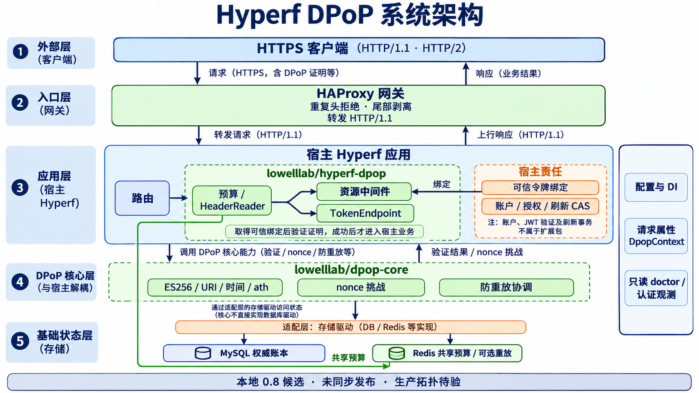
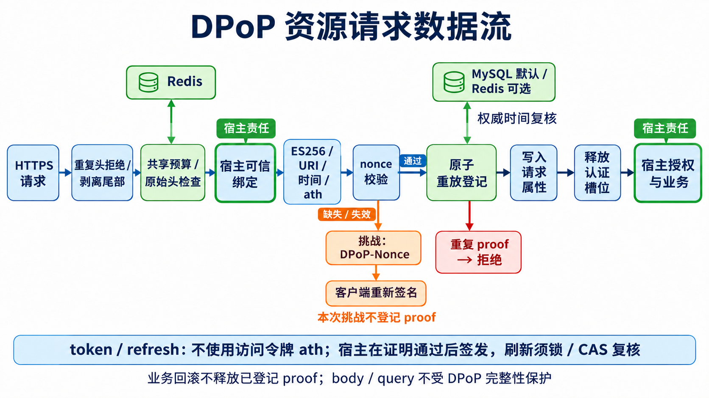

# 架构全景

本文描述当前本地工作区的实际组织，实施契约为 0.8，对应正式发行0.1.0；版本与验证见[发行记录](../../docs/release-0.1.0.md)。规则要求另见[架构约束](./constraints.md)，具体证据见[最新复审](../../docs/review-deep-20261103.md)。



配图保留2026-11-03初始化时的发布前快照；图内“未发布/本地候选”状态仅表示绘图时点。包职责与数据流未变，当前发行状态以正文和发布记录为准。

## 系统组件

| 组件 | 实际职责 | 代码入口 |
| --- | --- | --- |
| 入口网关 | HTTPS 终止；检查完整认证字段数和逗号列表；拒绝认证 Trailer 声明并剥离实际请求尾部；固定 HTTP/1.1 后端 | [HAProxy 模板](../../packages/hyperf-dpop/publish/haproxy.cfg) |
| 配置与依赖工厂 | Composer extra 自动发现、DI 工厂、发布项、启动监听器和可选 CLI 注册 | [ConfigProvider](../../packages/hyperf-dpop/src/ConfigProvider.php)、[Factory](../../packages/hyperf-dpop/src/Factory.php) |
| 资源中间件 | 准入预算、认证字段、可信绑定、proof 认证、请求身份及错误映射 | [DpopMiddleware](../../packages/hyperf-dpop/src/Middleware/DpopMiddleware.php) |
| 签发/刷新辅助器 | 在宿主产生签发/刷新副作用前验证证明；刷新使用宿主可信旧绑定 | [TokenEndpoint](../../packages/hyperf-dpop/src/TokenEndpoint.php) |
| 协议核心 | 解析与 ES256 验签、URI/方法/时间/ath/公钥校验、nonce 协调及重放登记 | [Authenticator](../../packages/dpop-core/src/Authenticator.php)、[ProofVerifier](../../packages/dpop-core/src/Protocol/ProofVerifier.php) |
| 存储与预算适配 | 专用 PDO 的 MySQL 独立事务、Redis Lua 重放、Redis 共享预算及本地并发槽 | [存储目录](../../packages/hyperf-dpop/src/Store)、[预算实现](../../packages/hyperf-dpop/src/Admission/RedisAdmissionBudget.php) |
| 宿主身份与业务 | JWT/会话验证、账户、撤销、刷新事务、业务授权；不由扩展包代办 | [接口目录](../../packages/hyperf-dpop/src/Contract) |

## 模块划分

```text
hyperf-dpop/
├── packages/dpop-core/        框架无关核心，独立 library 根
├── packages/hyperf-dpop/      Hyperf 适配，含 src 与 publish
├── examples/hyperf/           仅用于接入演示和隔离验证的宿主
├── tests/                    协议、存储、取消、CLI、HTTP/TLS/网关与互操作
├── tools/                    schema fixture、检查、导出及消费验证
├── docker/                   PHP/Swoole 测试运行时构建
├── compose.yaml              隔离 MySQL/Redis 与测试容器
├── compose.gateway.yaml      HAProxy 与真实 HTTP/2 尾帧测试叠加配置
├── docs/                     接入、部署、发布及验证记录
└── spec/                     当前 feature、实施记录与全局知识
```

核心只依赖协议库、OpenSSL 和 PSR 时钟等通用接口，不读取宿主全局 env，也不依赖 Hyperf、Swoole、账号表或 Redis 实现。适配层实现 `ReplayStoreInterface`、nonce/认证工厂与宿主集成；业务绑定由宿主实现 resolver 后注入。

适配层通过 PSR 请求属性传递 `DpopContext`。标准 Hyperf 请求代理通过不可变 PSR 操作访问底层请求，保持当前协程 `RequestContext` 不变；单例服务不保存当前用户、token 或请求状态。

## 数据流



### 资源请求

1. 网关检查原始认证字段和尾部策略，HTTPS 客户端可用 HTTP/1.1 或 HTTP/2；后端接收 HTTP/1.1。
2. `DpopMiddleware` 进入有限预算，`HeaderReader` 检查 PSR 多值、原始字段及源一致性。附带原生 Swoole 对象时，不可读取或无法核验的链路失败关闭。
3. 宿主 `TokenBindingResolverInterface` 验证令牌有效性、租户和撤销，提供可信公钥绑定及主体。
4. 核心严格解析 proof，调用 JOSE 执行 ES256 验签，校验方法、公开 URI、时间、ath 与绑定。
5. 缺失/失效 nonce 时发挑战，不登记该次 proof；通过后在权威存储复核时间并原子登记。
6. 适配层创建请求上下文、释放认证槽位，再调用宿主业务。业务异常与认证错误分别传播；宿主事务回滚不删除已提交的 proof。

图中主要标示成功路径；nonce 挑战、拒绝、异常和取消路径也通过 finally 释放已取得的认证槽位。挑战阶段不登记本次 proof，客户端重新签名后再次走完整验证流程。

### token 与 refresh

辅助器复用同一证明、nonce 和重放协调流程，但不校验访问令牌 ath。刷新先通过只读 resolver 取得旧绑定；证明成功后由宿主行锁/CAS 再检查旧凭据并轮换。账户认证、JWT 签发及轮换事务属于宿主边界。

## 外部集成

| 集成 | 当前代码中的方式 | 边界 |
| --- | --- | --- |
| MySQL | PDO、显式 DDL、专用连接、独立事务及数据库时间 | 默认防重放；不借宿主事务 |
| Redis | Hyperf 池化客户端及 Lua，Redis TIME | 默认共享预算；可选重放弱于 MySQL 的状态恢复保证 |
| JOSE | `web-token/jwt-library` 执行 JWS/ES256 | 不自行实现椭圆曲线签名算法 |
| 宿主令牌系统 | PSR 请求感知的绑定接口；JWT 或不透明会话均可 | 绑定须来自可信验证，不信任客户端自报 jkt |
| HTTPS/网关 | HAProxy 3.2 模板及宿主证书部署 | 模板不会自动创建证书或隔离网络 |

MySQL/Redis 的端口、账号、表名及 namespace 由配置与部署决定；现有 Compose 是隔离实验环境，不能复制其中的测试凭据作为生产配置。Redis 须设置有限连接、读取和池等待超时。

当前实验配置中，数据库服务为 `mysql:3306`，Redis 为 `redis:6379`，均在容器网络内部；MySQL 使用专用测试账号，Redis 通过 Hyperf 连接池适配。生产认证材料由宿主配置和密钥管理注入，本页不记录具体凭据。

## 部署拓扑

建议入口为“客户端 HTTPS → 检查原始字段的网关 → 仅网关可达的 Hyperf HTTP/1.1 → MySQL/Redis”。公开 origin 使用固定可信配置，不由客户端 Host/Forwarded 自动推断。

Swoole 原生 HTTP/2 无原始头，受保护入口返回 503；原生 HTTP/1 尾部报文可能在进入 PHP 前等待。当前本地网关链路通过剥离尾部和后端隔离处理这些边界，真实 CDN/Ingress 与防火墙仍待宿主验收。

测试容器镜像验证 PHP 8.5.12、Swoole 6.2.4、Hyperf Framework 3.2.0、JOSE 4.2.4；HAProxy 3.2.26 和 Node 24.22.2 用于真实协议测试。Node 是测试依赖，不是扩展运行依赖。MySQL/Redis 实验容器无宿主公开端口，MySQL 使用 tmpfs。

| 仓库内实验入口 | 实际监听/转发 | 用途 |
| --- | --- | --- |
| Hyperf HTTP 示例 | `127.0.0.1:9509` | 模拟 TLS 终止后的后端 |
| Hyperf TLS 示例 | `127.0.0.1:9510` | 临时证书、CA/主机名与真实 TLS 检查 |
| 网关验证叠加配置 | HTTPS `127.0.0.1:9511` → HTTP `127.0.0.1:9509` | 两种客户端协议及尾部剥离 |
| 原生协议探针 | TLS `127.0.0.1:9512` | 原生请求及标准代理的边界诊断 |

这些端口位于隔离容器内，不是生产监听约定。示例路由来自 [routes.php](../../examples/hyperf/config/routes.php)：`/health`、`/token`、`/refresh`、`/jwt/token`、`/items`、`/jwt/items`、`/groups/{group}` 和 `/revoke`；`/Items` 与 `POST /items` 还用于大小写/原始报文验证。所有身份与密钥是 fixture，包不自动注册这些业务路由。

只读 doctor 的成功结果仅代表其检查项通过，不替代上述真实认证、协议入口和生产拓扑的验证。

## 开发仓库与分发

开发主仓为 [hyperf-dpop](https://github.com/lowelllab/hyperf-dpop)，根 Composer 名是 `lowelllab/hyperf-dpop-workspace`、类型 `project`。两个包各自发布到 [dpop-core](https://github.com/lowelllab/dpop-core) 与 [hyperf-dpop-package](https://github.com/lowelllab/hyperf-dpop-package) 的 library 根目录。

本地导出工具只生成文件与摘要；验证器在导出副本创建本地 VCS 仓库并执行干净消费，不自动推送、创建标签或提交 Packagist。0.1.0已在两个发布仓创建正式标签及GitHub Latest发行，Packagist与独立消费核对：核心f8fae12、适配91026a2。公开消费及远端CI状态以[发布记录](../../docs/release-0.1.0.md)为准。

---
*最后更新：2026-11-03 — 初始化生成。*
