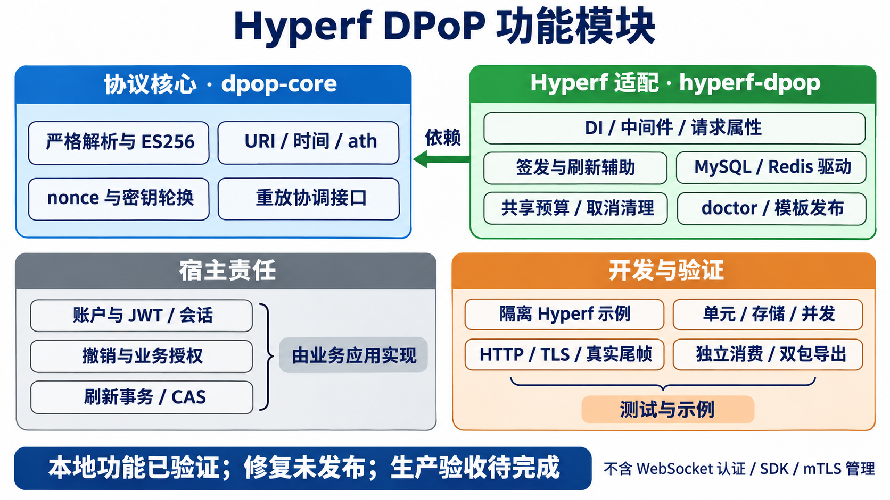

# 已有功能清单

图中“密钥轮换”指服务端 nonce 密钥轮换；SDK 指客户端 SDK。

本清单描述当前本地 0.8 候选的已有能力。实现、局部验证、公开分发和生产验收分别列示；当前公开适配快照不包含全部本地修复。

## 协议核心

- **严格输入解析**：限制 proof 大小，检查 base64url 与重复 JSON 键、嵌套深度和字段类型。
- **ES256/P-256**：使用 JOSE 执行签名验证，校验公开 JWK 坐标及用途元数据、生成标准公钥指纹，拒绝私钥与远程取钥头。
- **目标绑定**：区分大小写的方法与路径比较，规范化 scheme/host/默认端口、非保留编码和点路径，保留有意义的保留字符编码。
- **时间窗口**：验证 iat 与可选 exp/nbf；存储登记时再次使用权威时间验证，拒绝排队后过期或尚未生效的证明。
- **访问令牌摘要**：资源请求校验 access token 的 ath 与可信密钥绑定；刷新凭据不作为 ath。
- **nonce 协调**：HMAC nonce、有效期、随机盐和旧密钥轮换；隔离 token/resource 用途及公开 origin，提供挑战响应。
- **原子重放协调**：只有 proof/绑定/nonce 验证通过才调用共享存储登记；同一安全域中的重复 jti 被拒绝。

## Hyperf 集成

- **自动发现与 DI**：Composer extra 注册 ConfigProvider，提供明确工厂及可替换接口。
- **资源中间件**：校验来源、预算、认证字段及绑定，创建请求身份，并保持宿主业务异常语义。
- **token/refresh 辅助**：验证签发和刷新入口的持钥证明；刷新使用宿主可信旧绑定。
- **请求身份隔离**：使用不可变 `DpopContext` 请求属性；标准代理访问底层请求不改变协程上下文。
- **认证字段防歧义**：拒绝重复/列表字段；对附带原生 Swoole 对象的 HTTP/1 请求比较起始 raw 与 PSR 凭据；分块载荷按长度跳过并拒绝真实认证尾部。
- **原生 HTTP/2 保护**：无法核验原始头的 Swoole 原生 HTTP/2 受保护请求失败关闭为 503；正常 HTTP/2 客户端通过网关使用。
- **错误响应与观测**：保留协议状态、nonce/挑战/限流头；认证指标只传类别和耗时，指标异常不改变认证结果。

## 存储、预算与诊断

- **MySQL 默认账本**：精确检查 InnoDB/schema/完整唯一维度，专用连接和独立提交，按数据库时间防重放及有界过期清理。
- **Redis 可选重放**：Lua 原子 NX/TTL 与 Redis TIME 复核；状态丢失的恢复风险明确保留。
- **共享准入预算**：Redis 跨 Worker/实例全局预算、类别/来源预算与窗口重试建议；有限进程内并发槽只覆盖认证阶段。
- **取消与异常清理**：不在取消后进入业务，释放认证容量；提交不确定保持拒绝。
- **启动检查**：启动前解析配置和依赖，不在 fork 前创建实际数据库/socket 连接。
- **只读 doctor**：检查配置、resolver、重放 schema 与预算连通；自定义实现缺 probe 时标记 unverified。

## 显式接入与网关

- **配置发布**：复制到宿主 `config/autoload/dpop.php`，无 force 不覆盖。
- **schema 发布**：复制 DDL，由宿主迁移流程执行；包不自动运行 SQL。
- **gateway 发布**：复制 HAProxy 配置，不部署服务；原始字段去重、认证 Trailer 声明拒绝及实际请求尾部剥离，固定 HTTP/1.1 后端。
- **公开 URI 接口**：默认固定 origin 和路径前缀映射；支持宿主实现可信自定义解析器。
- **宿主责任接口**：访问绑定、刷新绑定、重放/预算探测、错误响应及认证观测均有接口边界。

## 示例与验证工具

- **隔离 Hyperf 示例**：opaque 会话、JWT、签发、资源、刷新和撤销流程；fixture 路由不能直接当生产账号服务。
- **协议与存储测试**：PHPUnit、PHPStan、语法、跨进程竞争、协程取消及生产 CLI 发布/缓存验证。
- **真实 HTTP/TLS**：多 Worker 真实请求、保留编码路径、证书/主机名、重放竞争和身份隔离。
- **真实尾部帧**：PHP 原始 HTTP/1 请求，以及独立 Node crypto 签名的真实 HTTP/2 trailing HEADERS。
- **消费与导出**：白名单生成两个包根及 SHA256；本地 VCS、公开 Git/Packagist 安装和独立宿主分别保留证据。
- **使用文档**：提供 resolver、控制器、DI/路由、PHP 客户端、错误、存储与网关接入说明。

## 状态与验证边界

| 项目 | 当前事实 |
| --- | --- |
| 本地实现 | 双包功能及 0.8 入口修复已实现；PHP 命名空间保持兼容 |
| 最新本地回归 | 153 测试/281 断言、PHPStan6、84语法、CLI17、HTTP27/TLS12 |
| 网关与尾帧 | 180 网关检查、17 项真实 HTTP/2 尾帧通过；原生等待观察另列限制 |
| 独立宿主 | 无开发依赖，四组各 87 PASS/0 LIMITATION；49 包文件逐项匹配，完整复跑脚本已执行 |
| 公开分发 | 核心/适配包已登记开发分支；本地 0.8 修复未推送，没有稳定标签 |
| 原生 Swoole 限制 | HTTP/2 无 raw；HTTP/1 尾部报文可能在 PHP 前等待，须网关剥离及后端隔离 |
| 生产待验 | 真实 CDN/Ingress/网络策略、目标容量/SLO、HA/状态丢失/备份恢复、独立安全审计 |
| 不在现有范围 | 账号系统、完整 OAuth 服务器、WebSocket 认证、客户端 SDK、mTLS 管理 |

[最新审核证据](../../docs/review-deep-20261103.md)与[结构化结果](../../docs/review-deep-20261103.json)是本表的定位入口。历史测试计数不等于当前新代码已通过，重复执行同一集合也不计为更多独立场景。

---
*最后更新：2026-11-03 — 初始化生成。*
